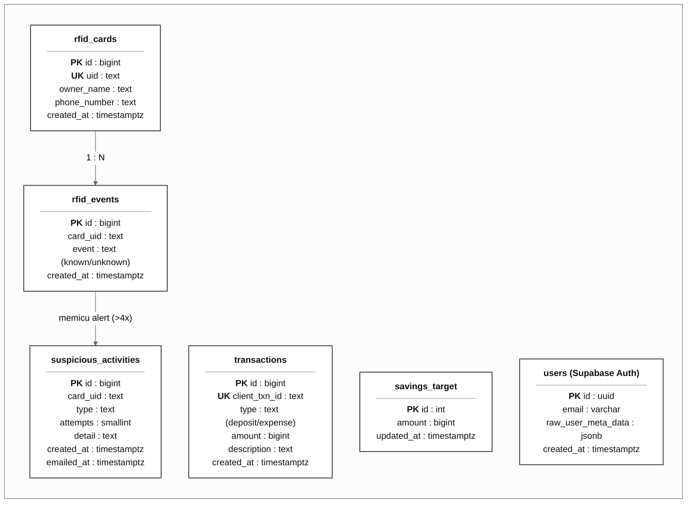
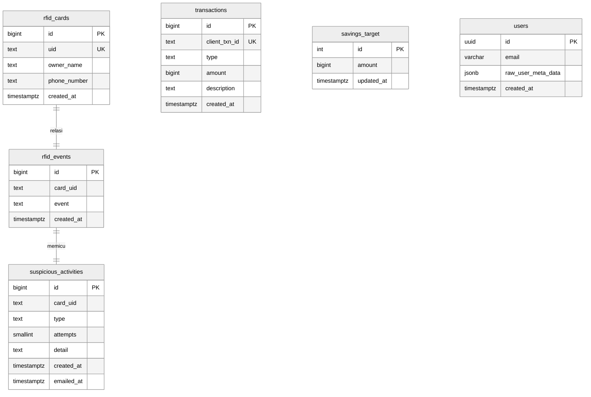

# Entity Relationship Diagram (ERD) - Smart Tabungan

### Versi 1: ERD Bersih (Hitam Putih / Netral & Garis Panah Biasa)

---

### Versi 2: Format `erDiagram` Netral (Hitam Putih, Garis Lurus Sederhana)

